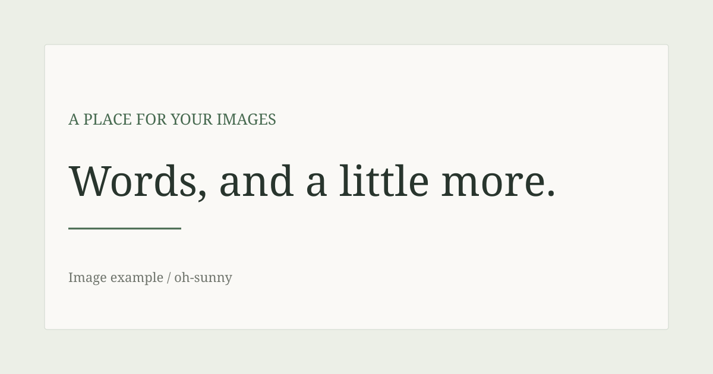

이 글은 **블로그 사용법을 보여주는 안내용 예시**입니다. 작성자의 경험을 대신 쓴 글이 아니며, 언제든 수정하거나 삭제할 수 있습니다.

## 글을 쓰는 방법

[글 저장소](https://github.com/oh-sunny/oh-sunny.github.io)의 `_posts` 폴더에서 **Add file → Create new file**을 선택합니다.

파일 이름은 `2026-11-14-my-first-note.md`처럼 **날짜-영문제목.md**로 적습니다. 새 글을 쓸 때는 그날 날짜로 바꾸세요.

본문 맨 위에 아래 내용을 넣고, 마지막 `---` 다음 줄부터 자유롭게 씁니다.

```yaml
---
title: "내 첫 번째 기록"
date: 2026-11-14 12:00:00 +0900
topic: "생각"
description: "이 글에서 다룰 내용을 한두 문장으로 적습니다."
---
```

`topic`은 **생각 / AI 공부 / 커리어 / 책·영화** 중 하나를 그대로 입력하면 됩니다.

글을 다 쓴 다음 **Commit changes**로 저장하면 배포가 진행됩니다. 사이트 반영에는 잠시 시간이 걸릴 수 있습니다.

## 사진을 넣는 방법

1. 저장소의 `assets/images` 폴더에 들어갑니다.
2. **Add file → Upload files**로 사진을 올리고 저장합니다.
3. 본문에 아래처럼 사진 경로를 적습니다.

```markdown

```

사진 파일 이름과 확장자는 업로드한 파일과 정확히 일치해야 합니다. 아래는 이미지 표시가 어떻게 보이는지 보여주는 **안내용 이미지**입니다.



사진은 화면 너비에 맞춰 줄어들고, 원래 비율을 유지합니다. 공개하기 전 사진의 위치 정보나 개인정보가 담기지 않았는지도 확인해 주세요.

## 자주 쓰는 문법

```markdown
## 소제목

**강조할 문장**

- 첫 번째 항목
- 두 번째 항목

[다른 사람 글 링크](https://example.com)

> 필요한 만큼 짧게 인용한 문장
```

스크랩은 원문 전체를 복사하기보다 **원문 링크 + 짧은 인용 + 내 생각**으로 남기는 편을 권합니다.

## 아직 공개하고 싶지 않다면

공개 저장소에 올린 파일은 블로그에 표시되지 않더라도 다른 사람이 볼 수 있습니다. `_drafts` 폴더나 `published: false`도 비밀 보관 기능이 아닙니다.

**민감한 초안은 개인 컴퓨터나 비공개 메모에 보관한 뒤**, 공개할 때만 이 저장소에 올리세요. 한 번 공개한 파일은 삭제 후에도 Git 기록이나 외부 사본에 남을 수 있습니다.

## 이 안내를 지우려면

`_posts/2026-11-14-start-here.md` 파일을 삭제하고 변경 사항을 저장하면 됩니다. 파일 삭제는 과거 Git 기록까지 지우는 것은 아닙니다.
